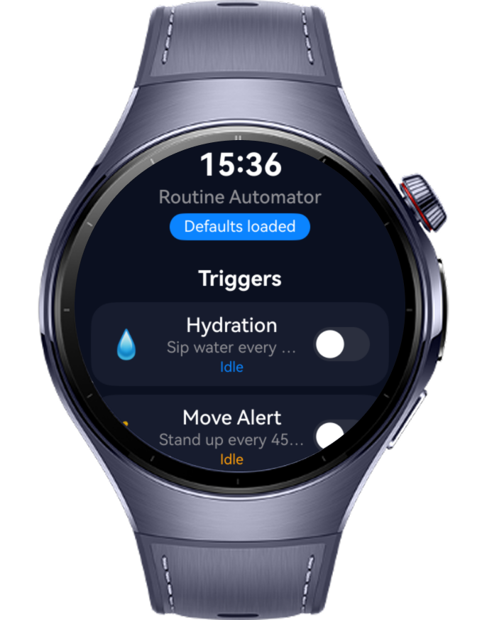
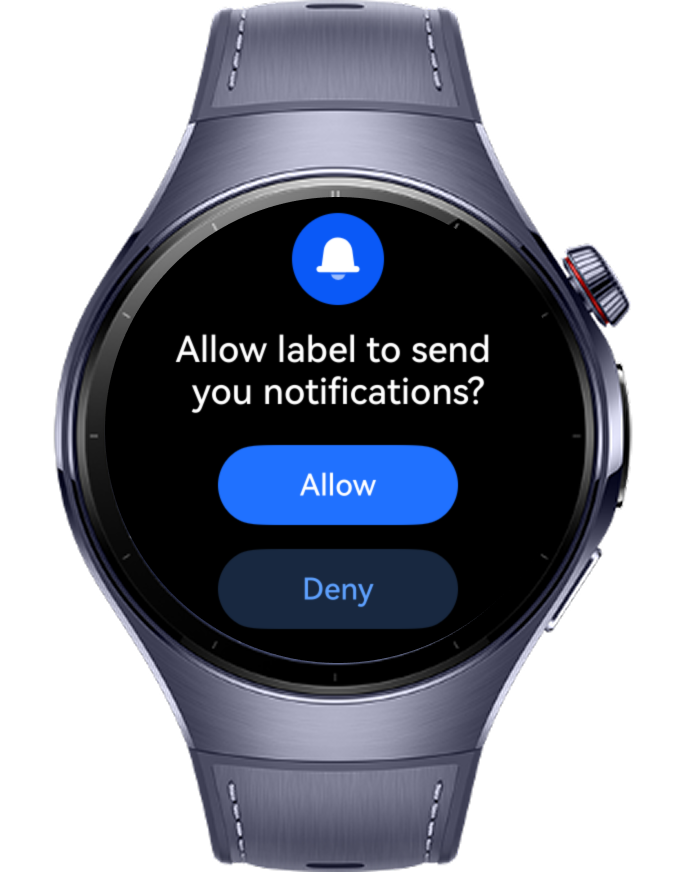
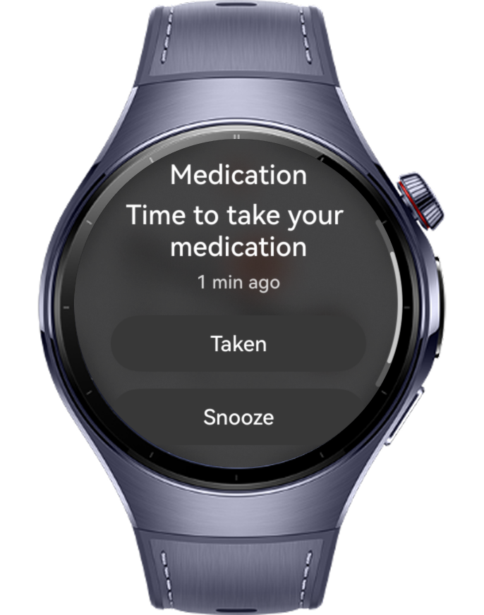

> **Note:** To access all shared projects, get information about environment setup, and view other guides, please visit [Explore-In-HMOS-Wearable Index](https://github.com/Explore-In-HMOS-Wearable/hmos-index).

# How to Build Ability Trigger Skills

A HarmonyOS wearable application — How to Build Ability Triggers Skills for health management — that chains ability triggers, skills, and deferred actions on a round Huawei Watch. Users toggle scheduled reminders (hourly hydration and sedentary alerts), discover and invoke skill-based intents (such as `startWorkout`), and set up a deferred medication reminder — a real daily alarm that fires a notification at the chosen time and launches a dedicated pill-tracker ability. Reminders are genuinely scheduled through `reminderAgentManager`, so they fire on the device even after the app is closed. Built with ArkTS and ArkUI on an MVVM architecture, the project showcases reactive state management using `@State`, `@Link`, `@ObjectLink`, and `@Observed` for seamless data binding, together with `reminderAgentManager` (real reminders/alarms), `WantAgent` + `TriggerInfo` (pending-intent skill invocation), `abilityDelegatorRegistry`, `AtomicServiceOptions`, notification enablement, and runtime permission handling. Every screen is programmatically fitted to the circular display via `@ohos.display`, keeping content inside a corner-safe inscribed square and clipping the root to a circle. The modular component structure makes it easy to extend with additional triggers, skills, or deferred agents. Perfect for developers learning HarmonyOS wearable development and advanced ability/lifecycle patterns.
# Preview

<div>
  
  
  
</div>

# Use Cases

- Skill-based intent discovery with action and entity filters (e.g. `startWorkout`)
- Real scheduled reminders via `reminderAgentManager` countdown timers (hourly hydration, sedentary alerts)
- A real deferred medication alarm (`reminderAgentManager`) that fires at a set time and launches the pill-tracker ability
- Genuine skill invocation through a `WantAgent` pending intent (`WantAgentInfo` + `TriggerInfo`)
- Notification enablement (`notificationManager`) so reminders actually surface on the watch
- Automated ability lifecycle testing with `abilityDelegatorRegistry`
- Lightweight companion configuration with `AtomicServiceOptions`
- Runtime permission checks and declarations via the security (`abilityAccessCtrl`) module
- Round-screen optimized MVVM UI with reactive ArkUI decorators
- 
# Technology

## Stack

- **Languages**: ArkTS, ArkUI
- **Frameworks**: HarmonyOS SDK 6.1.1 (API 12+, stage model)
- **Tools**: DevEco Studio NEXT
- **Libraries**:
    - `@kit.AbilityKit`
    - `@kit.ArkUI`
    - `@kit.BackgroundTasksKit`
    - `@kit.NotificationKit`
    - `@kit.TestKit`
    - `@kit.PerformanceAnalysisKit`
    - `@kit.BasicServicesKit`

# Directory Structure

```
└── entry/src/main/
├── ets/
│   ├── model/
│   │   ├── Constants.ets
│   │   └── RoutineModel.ets
│   ├── viewmodel/
│   │   └── RoutineViewModel.ets
│   ├── pages/
│   │   ├── Index.ets
│   ├── components/
│   │   ├── HeaderComponent.ets
│   │   ├── TriggerListControl.ets
│   │   ├── SkillIntentHandler.ets
│   │   └── DeferredActionManager.ets
│   ├── entryability/
│   │   ├── EntryAbility.ets
│   │   └── PillTrackerAbility.ets
│   └── test/
│   │    ├── AbilityTestDelegator.ets
├── module.json5
└── resources/
```

# Constraints and Restrictions

## Supported Devices

- Huawei Watch 5
- DevEco Studio wearable simulator

# LICENSE

**How to Build Ability Triggers Skills** is distributed under the terms of the MIT License.
See the [LICENSE](./LICENSE) for more information.
